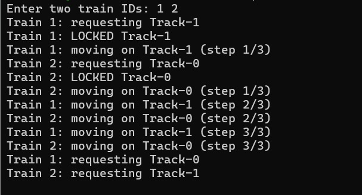
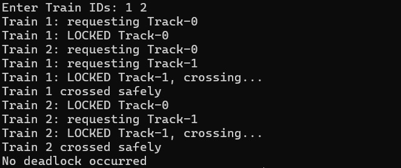
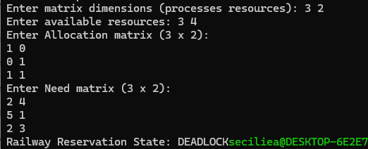

# Deadlocks

## Use Case

### Railway Track Resource Management

This project demonstrates how deadlocks can occur when multiple
trains compete for limited shared resources such as railway tracks.

## Programs

### 1. Deadlock

Demonstrates a situation where processes wait indefinitely for
resources that are held by each other.

### 2. Deadlock Handling

Demonstrates methods used to detect and handle deadlock situations.

### 3. Banker's Algorithm

Demonstrates deadlock avoidance by checking resource allocation
and ensuring that the system remains in a safe state.

## Concepts Used

* Deadlock
* Resource Allocation
* Deadlock Detection
* Deadlock Handling
* Deadlock Avoidance
* Safe State
* Banker's Algorithm
* Process Synchronization

## Program Output

### Deadlock

### Deadlock Handling

### Banker's Algorithm

